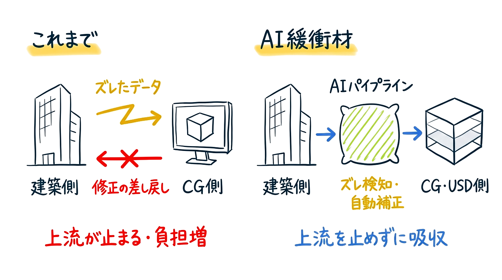
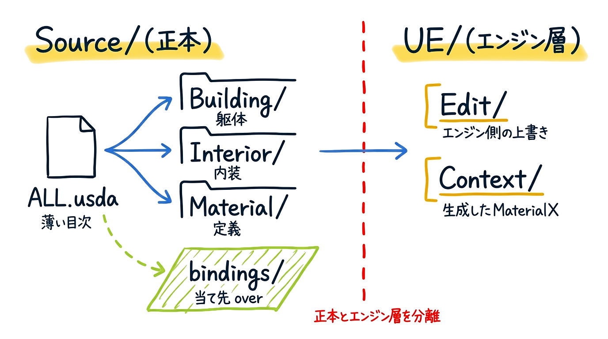
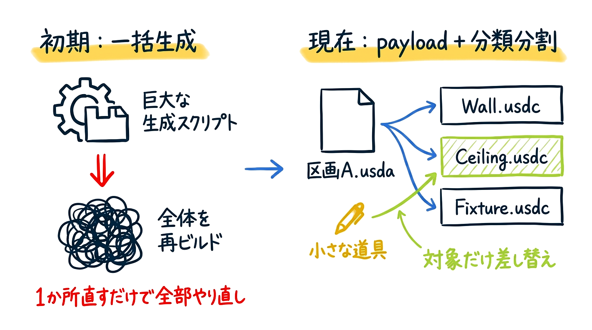
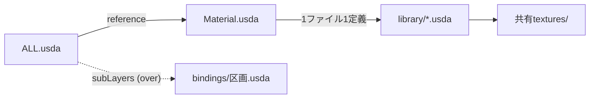
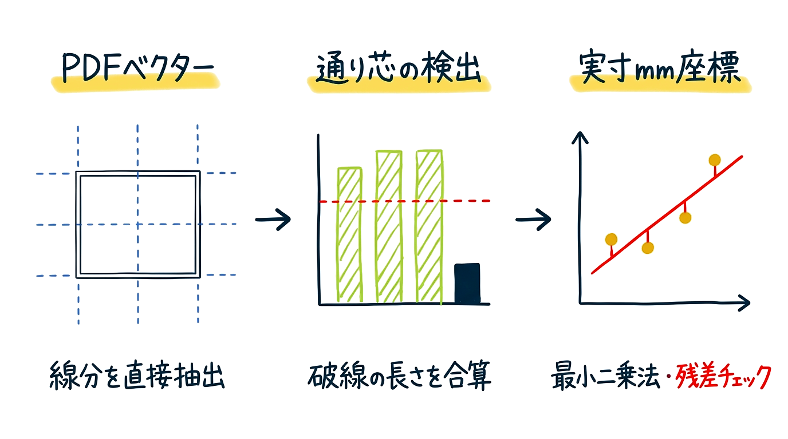
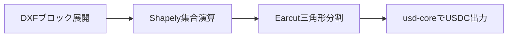
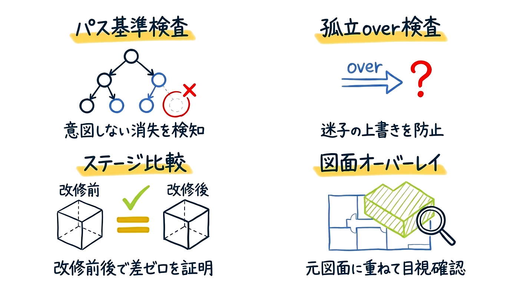

## はじめに

こんにちは、PYのテクニカルアーティストの与羽です。

建築の設計データをもとに、リアルタイムエンジンやシミュレーションで使える3D空間をOpenUSDで整備する仕事をしています。この現場にコーディングエージェント（Claude Code）を本格導入したところ、データの扱い方もチームとの向き合い方も大きく変わりました。

本記事では、非公開案件のため具体的な固有名詞や細部は伏せつつ、建築データとコーディングエージェントの相性、紆余曲折を経て辿り着いたUSDの構成設計、そしてAIが裏側で動かしている技術の仕組みを振り返ります。建築×CGや制作会社、USDパイプラインに関わる方のヒントになれば嬉しいです。

---

## 建築データとAIの相性

### 正本から建てる作業はAIが得意

コーディングエージェントが賢くなるにつれて、図面やDXFを読み取って自律的にモデリングする精度が一気に上がりました。アート的なセンスを問う作業ではなく、図面という正本から寸法や整合性を詰めていく仕事はAIと非常に相性が良いです。

BIMデータが用意されている場合、躯体や構造といった骨格はそこから多くを取得できます。一方で、見た目に関わるマテリアルや細かな照明・内装などはBIMから抜け落ちがちです。

そうした欠落を図面と照らし合わせながらAIが補完し、日々細部を詰めて建物を立ち上げてくれる体験は、これまでのCG制作とはまったく別次元の手応えがありました。

### 乱立する形式をPythonで捌く

建築の現場では、Revit（BIM/IFC）、Rhinoceros（`.3dm`）、Vectorworks、SketchUp（`.skp`）、DXF、PDF図面など、実にさまざまなソフトからデータが送られてきます。これらをどうやってUSDへ変換し統合するかが最初の壁でした。

HoudiniやUnreal Engine、BlenderをAIに操作させる試みも行いましたが、結局AIが一番得意なのは「Pythonコードを書いて直接データを処理すること」でした。


BIMのIFCやRhinoの `.3dm`、DXF、PDFには優秀なOSS解析ライブラリが揃っています。SketchUpだけは直接読めるOSS手段が乏しいため、専用の書き出しプラグインをAIと自作して変換パイプラインに組み込みました。

---

## AIが建築とCGの緩衝材になる

### 上流を止めずに不整合を引き受ける

受領した3Dデータと図面をAIで照合すると、階高のズレや形状の食い違いがいくつも見つかります。最初は不備を見つけて先方へ報告していましたが、そのやり取りの中で建築側とCG側の連携のあり方を深く考えさせられました。

建築チームは実際の建物を建てることが最優先で、スケジュールを止めるわけにはいきません。「きれいなデータをもらわないと動けない」という従来のエンジニア的な発想は、上流へ過度な負担を強いてしまいます。



AIのおかげで「今あるデータのズレを、こちら側で低コストに辻褄合わせする」という選択肢が現実になりました。先方へ負担をかけず、調整の苦労はAIに引き受けてもらうことで、AIがチーム間を滑らかにつなぐ**緩衝材**として機能してくれます。

### 工事しない立場だからできる割り切り

僕らは実際に建物を施工するわけではありません。図面とモデルのズレはきちんと一覧にして共有する一方、CG空間として破綻しない範囲の調整はパイプライン側で吸収してしまう方が全体が速く進みます。

もちろんシミュレーションに関わる寸法や位置関係は自動QAで厳密に守ります。それでもCGは建物が崩れたり人が怪我するわけではないため、見た目が成立すればよしとする柔軟な判断が効く点は、AI活用と相性が良いと感じています。

---

## 紆余曲折の末に辿り着いたUSD構成

今回のプロジェクトで一番試行錯誤を重ねたのが、OpenUSDのレイヤー構成とファイル粒度です。最初から理想の形を作れたわけではなく、運用上のつまずきを何度も踏みながら今の構成へ辿り着きました。

### 初期の失敗：overと一括生成の罠

最初は「非破壊編集こそUSDの強み」と考え、階高のズレ補正、形状の差し替え、LODや用途別の切り替えを、すべて `over` レイヤーと `variantSet` の重ね合わせで解決しようとしました。さらに、それらをコマンド1本で丸ごと再生成する巨大なビルドスクリプトも組んでいました。

しかし運用が進むと、いくつかの壁にぶつかります。

- 1箇所直すだけで巨大なスクリプトを全部流し直す直列作業になり、USDの並行編集の強みが死んでしまった
- `variantSet` や `over` が何重にも積まれ、最終状態がどの層から来ているのか人間にも追いにくくなった
- 下のレイヤーのプリムパスが少し変わるだけで、行き先を失った迷子の `over` が大量に発生する

教科書通りに「何でも非破壊で重ねる」だけでは、設計変更が頻発する建築データとAIの高速イテレーションには耐えきれませんでした。

### Sourceとエンジン層の責務分離

そこで思い切ってUSD全体を再設計しました。最初に引いた境界線が、どのツールで開いても同じであるべき正本（`Source/`）と、ゲームエンジン固有の調整や派生ファイルを載せる層（`UE/`）の分離です。



`Source/ALL.usda` は躯体・内装・マテリアルを `reference` で並べるだけの薄い目次に徹し、その上にマテリアルの当て先だけを `subLayers` で重ねます。

受けたフィードバックも `edits` 層に `over` として残さず、正本の該当ファイルへ直接反映して `edits` を常に空に保つ運用へ切り替えました。

:::details Source/ALL.usda のミニマルな構成イメージ
```usd:Source/ALL.usda
#usda 1.0
(
    defaultPrim = "World"
    metersPerUnit = 0.01
    upAxis = "Z"
    subLayers = [
        @./Material/bindings/Bindings.usda@
    ]
)

def Xform "World" ( kind = "assembly" )
{
    def Xform "Building" ( prepend references = @./Building/Building.usda@ ) {}
    def Xform "Interior" ( prepend references = @./Interior/Interior.usda@ ) {}
    def Scope "Looks"    ( prepend references = @./Material/Material.usda@ ) {}
}
```
:::

### 競合しない粒度への段階的な分割

ジオメトリのファイル粒度も、段階を踏みながら落ち着きました。最初は建物全体を一括生成していましたが、まずは「1区画＝1ファイル（`.usdc`）」へ分けて `payload` で読み込む構成へ移行しました。

ただ、部屋まるごと1ファイルだと数十MBの塊になり、天井だけ直したいときも壁や什器ごと巻き込んでしまいます。そこで最終的には「区画の入口 `.usda` を `payload` で読み込み、その中から分類ごとの `.usdc` を `subLayers` で並べる」2段構成にしました。



この粒度にしてから、図面の版が上がっても「天井だけ」「可動間仕切りだけ」といった単位で小さなスクリプトを流し直せるようになりました。同じ部屋でも壁と天井を別の人やAIが同時に触れるため、ファイル衝突も劇的に減っています。

### マテリアルと当て先の完全分離

マテリアル周りにも大きな紆余曲折がありました。一時は「1つのJSON設定表から全マテリアルを生成し、`variantSet` で用途別にMaterialXを切り替える」という凝った仕組みを試しています。

しかしチームからのフィードバックもあり、依存が複雑で複数人編集時に競合しやすいと判断して、JSON表も `variantSet` も思い切って廃止しました。最終的に落ち着いた約束はとてもシンプルです。

- ジオメトリ側（`base`）には `material:binding` を一切書かない
- マテリアル定義は「1マテリアル＝1 `.usda`」に分け、`UsdPreviewSurface` を正本にする
- テクスチャは共有フォルダへ集約し、重複をなくして相対パスで参照する
- バインディング（当て先）は区画ごとの `.usda` に分離し、`ALL.usda` から `over` で当てる



依存を「`ALL` → `Material` → 個別 `.usda` → 共有テクスチャ」の一本道に削ぎ落としたことで、値や当て先を直すときも対象ファイル1つだけを触れば済むようになりました。

### ビューア自作と安全な同期運用

USDの構成を整えても、確認に毎回重いDCCツールを起動していてはイテレーションが回りません。そこで自作の軽量3Dインスペクター [yw-look](https://look.yohawing.com/) を使い、階層・マテリアル・参照切れを数秒で確認できる環境を整えました。

チーム共有にはOmniverse Nucleusとの同期ツールを使っていますが、AIが大量に書き換える作業中は同期フォルダを直接触らないようにしました。ローカルのGit＋LFS作業場と同期用の写しを分け、自動QAを通過した変更だけを反映してから人間が共有する運用です。

ちなみに `TODO.md` やモデリングのルール文書は私自身は書いていません。「ちゃんと整理しよう」と方針を出し、AIが図面から投げかけてくる細かい確認に答えながら、私自身も建築知識をキャッチアップしつつ並走していました。

---

## 技術トピック：AIの裏側

ここからは、私がAIへ方針を出して任せていた裏側で、実際にどのような技術が動いているのかを掘り下げます。コードを読み解いてみると、建築データとUSDならではの工夫がいくつも詰まっていました。

### PDFベクター解析と通り芯合わせ

設計事務所から届くPDF図面は、ラスター画像ではなくベクターデータであることが多いです。Pythonの [PyMuPDF](https://pymupdf.readthedocs.io/)（`pymupdf`）の `get_drawings()` を使うと、ページ内の線分や色情報をそのまま座標として取り出せます。

厄介なのは、通り芯の記号や寸法文字がアウトライン化されていてテキストとして読めない点と、ページに回転（270°など）が付いている点です。そこでAIは、文字に頼らず線分の幾何情報から通り芯を自動検出して位置合わせをしていました。



通り芯の破線は短い線分の集まりなので、同じ座標ビンに並ぶ線分の長さを合算して候補線を抽出します。その候補へ通り芯の実寸テーブルを最小二乗法（`np.linalg.lstsq`）で当てはめ、残差が許容比を超えたら即座に停止させる安全策が入っています。

:::details 最小二乗キャリブレーションの要点（擬似コード）
```python:calibrate_axis.py
# 1. 同一座標に並ぶ水平・垂直線分の長さを合算して通り芯候補を抽出
# 2. 公称縮尺を初期値に、候補と実寸テーブルの最多一致アンカーを探索
# 3. 許容誤差を段階的に絞りながら最小二乗法で model = offset + k * pt を解く
for tol in (2.0, 1.0, 0.6):
    matched = match_candidates(cands, model_mm, k, offset, tol)
    A = np.vstack([np.ones_like(P), P]).T
    (offset, k), *_ = np.linalg.lstsq(A, model_mm[ok], rcond=None)

# 残差が通り芯最小間隔の 0.5% を超えたら異常として停止
if np.max(np.abs(residuals)) > min_spacing * 0.005:
    raise CalibError("residual exceeds tolerance")
```
:::

### DXFの塗りからUSDを直接組む

内装の天井や壁などのDXF図面では、高さや仕上げの違いがハッチ（塗り）の色で描き分けられていることがあります。ただし図面上では塗りが何重にも重ねて描かれているため、そのまま押し出すとメッシュが重複してしまいます。

そこで `ezdxf` でブロックを再帰展開し、`shapely` の集合演算で「図面上で見えている領域」だけを正確に抜き出します。その後、`mapbox-earcut` で三角形分割し、UVと法線を計算して `usd-core` で直接 `.usdc` ファイルを書き出します。



さらに、同じ図面から実行すれば毎回バイト単位で同じ出力になる（決定論的である）ように設計されています。重いDCCを立ち上げず数秒で対象分類の `.usdc` だけを再生成できるため、図面の版が上がっても素早く追従できます。

### 壊していないことを証明する自動QA

USDとコーディングエージェントの組み合わせで特に強力だったのが、**自動QA**です。USDは構造とPython API（`pxr`）が明確なため、ソフトウェア開発のテストコードと同じ感覚で3Dデータの品質を機械的に検証できます。



前述のようなファイル分割やマテリアル分離の大改修も、改修前後の2つのステージを全プリム・全属性・全バインディングにわたって総当たり比較することで進めました。「構成を大改造したのに合成結果の差はゼロ」と証明できるからこそ、恐れずにUSDをリファクタリングできます。

:::details 共有前チェックゲートで実際に検証している主な項目
- 基準ファイルに登録された全プリムパス（非アクティブ配下やインスタンスプロキシ含む）が意図せず消えていないか
- リポジトリ内のすべての `over` が、いずれかのエントリーポイント上で実在する定義済みプリムへ当たっているか
- `GetCompositionErrors()` や `UsdUtils.ComputeAllDependencies()` で合成エラー・参照切れがゼロか
- リポジトリ外への参照や、環境依存の絶対パス（`D:/...` など）が混入していないか
- 生成した3Dの断面・平面を元図面（PDF/DXF）へ重ねたPNGと面積差・位置ズレ統計に異常がないか
:::

### USD正本からMaterialX変換

マテリアルをUSD側とゲームエンジン側で二重管理すると、更新のたびに手直しが消えてしまいます。そこで正本は各マテリアルのUSDファイル（`UsdPreviewSurface`）に統一し、エンジン向けの [MaterialX](https://materialx.org/)（`.mtlx`）だけを生成する構成にしました。


実際にUnreal Engineへ読み込ませてみると、仕様の隙間に潜む細かな罠がいくつも見つかりました。こうした癖も変換スクリプト側のルールとバリデーションに閉じ込めることで、人が毎回気をつける運用をなくしています。

:::details リアルタイムエンジン × MaterialX 連携で見つかった主な罠
- マテリアル名の末尾が先頭ゼロなしの `_0` などの数字だと、エンジン側の内部名処理（FName）で末尾番号が切り落とされて別マテリアルへ照合ズレするため、末尾は0埋めを強制する
- 複数の `.mtlx` 文書が同じテクスチャファイルを参照すると一時領域のテクスチャを指してしまうケースがあるため、用途（コンテキスト）ごとに1つの `.mtlx` 文書へまとめる
- `UsdTransform2d` と MaterialX の `rotate2d` では回転方向が逆になるため、変換時に角度の符号を反転させる
- 変換完了前にエンジン同梱のMaterialX標準ライブラリに対してスキーマ検証を通し、独自nodedefの混入やテクスチャ欠損があれば書き出し自体を止める
:::

---

## まとめ

建築データとUSDとコーディングエージェントを組み合わせて見えてきたポイントを整理します。

- 図面やBIMという正本から寸法と整合性を詰めるモデリングは、AIと非常に相性が良い
- 乱立する建築フォーマットは、DCCを操作させるよりPythonとOSSライブラリで直接USDへ組む方が強い
- 不整合の調整をAIパイプラインで引き受けることで、AIが建築チームとCGチームの緩衝材になる
- `over` や一括生成に頼りすぎず、責務分離・分類単位の分割・マテリアル分離と自動QAを揃えると、安心してUSDを育てられる

データの不備を上流へ押し返すのではなく、AIの力を借りてこちら側でしなやかに吸収し、綺麗なUSDへ整えてチームへ届ける。そんなテクニカルアーティストらしい新しい立ち回りが見えてきたと感じています。

建築データやUSDパイプラインの整備に悩んでいる方は、まずは手元の図面やCADファイルをPythonとコーディングエージェントで解析してみるところから、ぜひ試してみてくださいね！

---

## 参考記事

- [OpenUSD 公式ドキュメント](https://openusd.org/)（Pixarが開発する3Dシーン記述フレームワークおよびPython API）
- [MaterialX](https://materialx.org/)（ツール間でマテリアルグラフを交換するためのオープン標準）
- [yw-look 公式サイト](https://look.yohawing.com/)（確認イテレーションの高速化に使っている自作の軽量3Dモデルインスペクター）
- [PyMuPDF](https://pymupdf.readthedocs.io/)（PDF図面からベクター線分や座標情報を抽出するためのPythonライブラリ）
- [ezdxf](https://ezdxf.readthedocs.io/)（DXF図面のブロック展開・エンティティ解析に利用しているPythonライブラリ）
- [IfcOpenShell](https://ifcopenshell.org/)（BIMのIFCデータをヘッドレスで解析・形状取得するためのOSS）
- [rhino3dm](https://mcneel.github.io/rhino3dm/python/api/)（Rhino本体を起動せずに `.3dm` ファイルを読み込む公式ライブラリ）
- [Shapely](https://shapely.readthedocs.io/)（DXFの重なり合う塗り領域を集合演算で整理するための2D幾何ライブラリ）
- [mapbox-earcut](https://github.com/mapbox/earcut)（穴あきポリゴンを高速に三角形分割するライブラリ）
