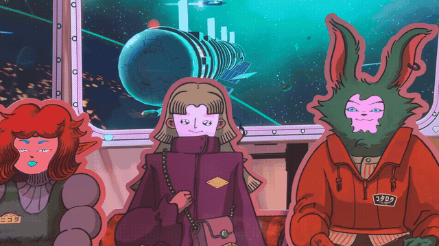
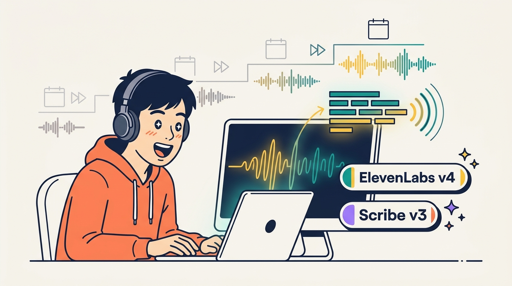
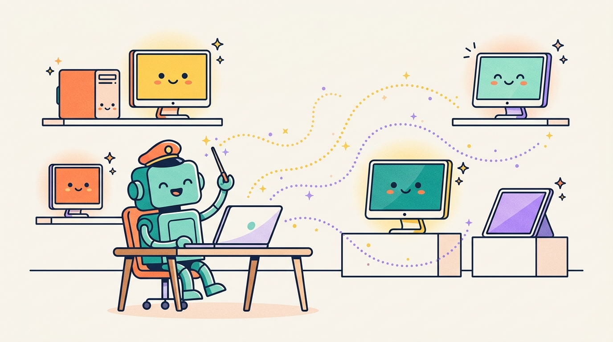
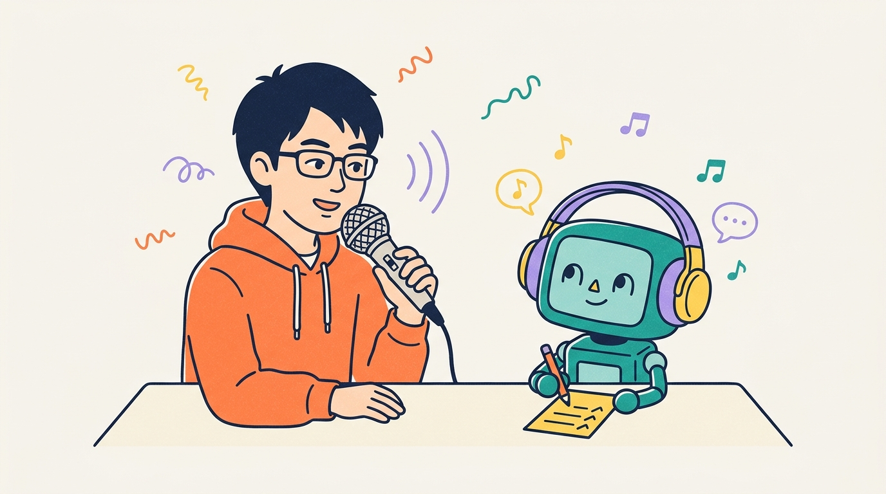
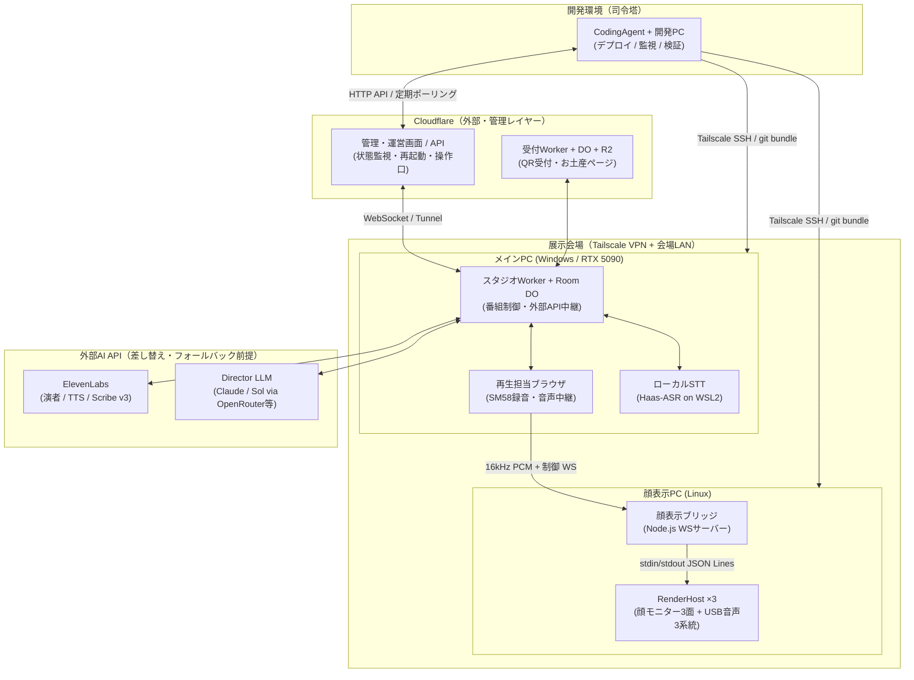
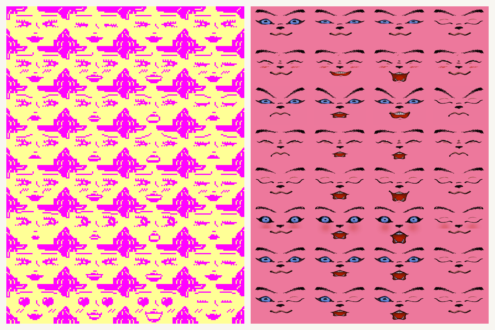
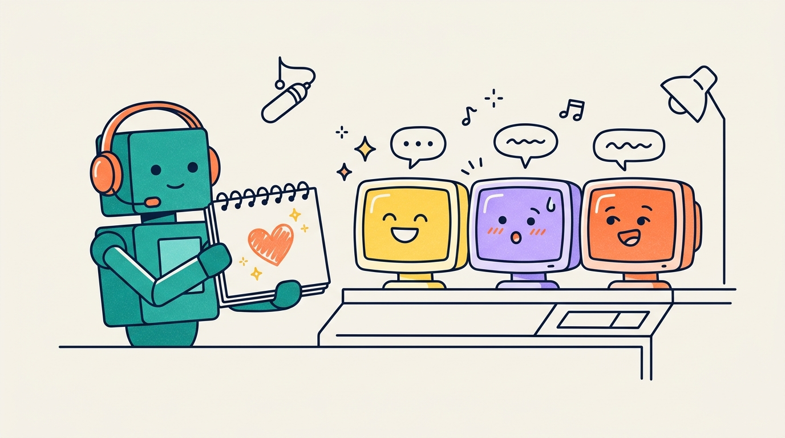
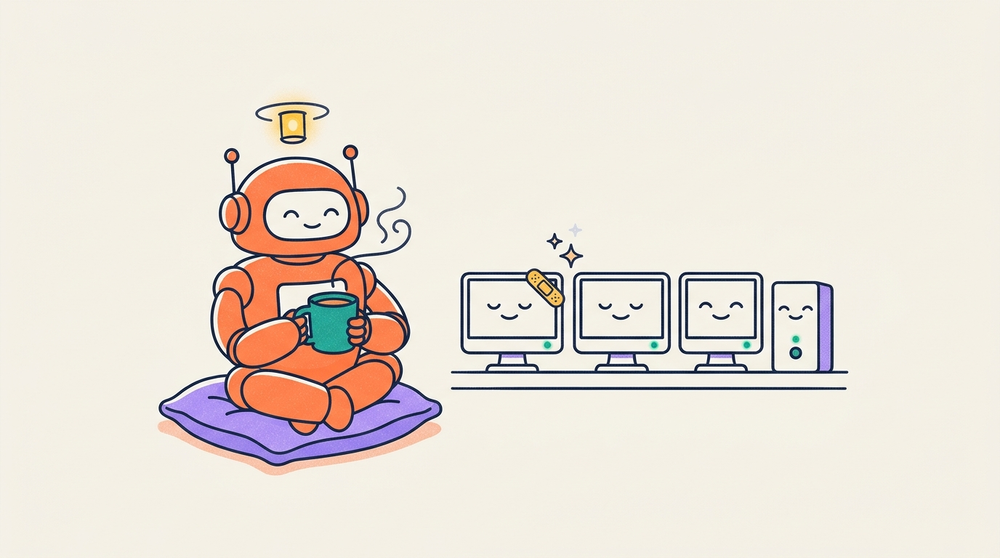

## はじめに

こんにちは、PYのテクニカルアーティストの与羽です。

昨年、大画面の没入体験としてAIと1対1で対話する展示を作りました。OpenAI Realtime APIを使い、画面の中の存在と喋るコンテンツでした。

今年はそこから一歩踏み込み、「もっと物理世界に出てきたAIと喋る体験」に挑戦しました。マネキンの頭にモニターを載せたり、パネルの顔にモニターを埋め込んだりして、人間側の空間へAIを出すイメージです。

10月と11月に立て続けに2本の展示を制作・運用しました。実装はほぼすべてCodingAgent（CodexやClaude Code）に任せ、自分はコードを読まずに設計・ディレクション・検証環境づくりに徹しています。


展示内容や会場の様子は別記事でまとめる予定です。今回は技術面に絞り、「**CodingAgentと展示システムをどう設計・検証・監視したか**」という実践方法と、AIまわりの裏側を共有します。

---

## 今回作った2つの展示（ざっくり概要）

前提として、2つの展示がどういうものだったかだけ短く触れておきます。

1本目は10月の虎ノ門広告祭で展示した「ウワサの待合所」です。レトロテレビ型の頭部を載せた5体のマネキンが普段は掛け合い劇を流し、きっかけを与えるとVoiceAgent対話に切り替わります。制作ツールから配信基盤まで約1ヶ月で作りました。


*レトロテレビ型の頭部にドット絵の顔を映した「ウワサの待合所」*

2本目は11月展示の「ラブシャトル」です。体験者1人と、宇宙船の窓を背にしたキャラパネル3体（顔モニター＋個別スピーカー内蔵）が即興の恋愛リアリティ番組を繰り広げます。お土産動画ページまで含め約3週間で作りました。


*パネルの顔部分に小型モニターを埋め込んだ「ラブシャトル」*

どちらもPoC・R&Dの色合いが強く、限られた期間で体験を盛り込み、展示中にもすぐ改善を回す必要がありました。

---

## コードを読まずに考えていたこと

今回の制作ではほとんどコードを読んでいません。やりたいことをひたすら言葉にしてエージェントへ伝え、動きを見ながら舵を切る進め方でした。

ただ丸投げすれば走り切れるわけではなく、人間側で意識して整えたポイントが大きく3つあります。

### 最新AIを追いかけてすぐ乗り換える

昨年の展示ではOpenAIのRealtime APIを使っていましたが、今年はElevenLabsへ移行しました。直近のクオリティの伸び方が大きく、自然な音声対話を作りやすくなっていたためです。



特に変化が速かったのが音声文字起こし（STT）です。10月時点ではKotoba-Whisperが最有力でしたが、すぐ後にローカルGPUで高速・高精度なHaas-ASRが登場しました。

さらにその直後、ElevenLabsのScribe v3が出てきて一気に本番採用へ切り替えました。本当に1〜2週間単位で別次元のモデルが出てくるため、毎日のように情報を追い、すぐ差し替えられる前提で組むのが一番効きました。

### AIが展示PCをさわれる環境と権限

展示では複数PCを連携させ、落ちないように監視し、改善をすぐデプロイする必要があります。そこで最初に、ネットワークと権限の土台をAIに作らせました。

自宅の開発PCから会場の全展示PCまでをTailscale（VPN）で繋ぎ、1台の司令塔PCからパスワードなしSSHと強い権限で操作できる構成です。これによりAI自身がリモートPCのログ確認・ビルド・再起動まで回せるようになりました。



あわせて、Cloudflare上に全台の状態監視や再起動ができる統合管理画面も置きました。人間が触りやすいだけでなく、「**AIがSSHなしでAPI経由から全台を見られる口**」として機能します。

いわば「展示用MCP」のような操作インターフェースができたことで、運用やトラブル調査をAIへ任せやすくなりました。展示中に異常がないかを定期ポーリングで監視する仕組みも、この上に載せています。

### 物理世界の音を検証データに落とす

展示制作が普通のWeb開発と違うのは、物理世界が絡む点です。会場の雑踏、スピーカーの回り込み、マイク特性、人の滑舌といった要素は、コードだけ見てもAIには検証できません。

1作目の「ウワサの待合所」では、そこがやり切れませんでした。現場の雑踏や会場内の音を含んだ実際のマイク収録データを持ち、機械的に聞き取りテストを回せる状態まで落とすべきでした。



2作目の「ラブシャトル」ではその反省を活かし、マイクをダイナミックマイク（SM58）＋スイッチ式のPush-to-Talkへ変更しました。そのうえで、自分の滑舌の悪い読み方も含めた固有名詞入りの録音データセットを自作しています。

現場へ行くと音環境は変わるので1回録って終わりではありませんが、物理のボトルネックをデータ化してAIへ渡すだけで、検証精度と改善スピードは段違いに上がりました。

---

## 技術トピック：システム設計の裏側

ここからは技術記事らしく、上の考え方を実際のシステムとしてどう組んだのか、アーキテクチャとAIまわりの工夫を整理します。

### 全体構成とマルチPC連携

2作目「ラブシャトル」の構成図です。自宅のCodingAgentが、Tailscale VPNとCloudflare API経由で会場の複数PCへデプロイ・監視・操作まで一気通貫で届きます。



1作目「ウワサの待合所」も基本思想は同じです。Cloudflare Workers + D1 + R2で作品配布と端末管理を束ね、各卓PCが `TableController`（Python）と `RenderHost`（C++）で描画・音声出力を回しています。

### RenderHost流用と共通シート

開発スピードに効いたのが、1作目のC++顔描画・音声ホスト `RenderHost` の流用です。本来は1プロセス最大2体の設計ですが、2作目で3体必要になった際、C++本体は一切改造しませんでした。

単体モードを3プロセス並列起動し、手前の薄いNode.jsブリッジからJSON Linesで制御する構成にすることで、短期間で3体運用へ対応しています。


*画風はまったく違いますが、4列×8行のスプライトシート仕様を統一して同じRenderHostで動かしています*

表情シート（`expression-spritesheet` v2）も統一しました。横4フレーム×縦8表情を並べ、会話用の7行を「F1: 閉、F2: 小、F3: 大、F4: 瞬き」として音量で口パクさせます。待機行を瞬き専用にし、聞き手の口が動く事故を構造的に防ぎました。

:::details 表情切替の細かい調整
顔表示側では発話途中の表情切替を行わないため、10文字以下の短いリアクションだけ感情別の行を使い、長台詞は目を開いた通常会話（`unique1`）で話すようにしています。喜・楽の行は目を細めた絵が多く、長台詞中ずっと目を閉じて見えるのを避けるためです。
:::

### マルチエージェント開発の回しかた

3週間で500コミット超（約5.5万行・テスト1,000件以上）のペースでは文脈がすぐ消えるため、仕様・プロトコル・TODOのMarkdownを常に正本とし、「実測結果と変更理由」をそのまま残しました。

- 実装・テストはCodexを主軸にしつつ、UI再設計や日本語コメディ台本は対象ファイルと制約を書いたブリーフでClaude Code（Sonnet / Fable）へ委譲
- 表情シート生成やタイムライン作品化など繰り返す工程は、検証スクリプト込みでスキル（`expression-spritesheet`・`timeline-production`）としてリポジトリ内に定義
- 展示直前に「1日連続稼働で止まるバグ」「結末判定の食い違い」を観点指定してエージェントに複数回レビューさせ、履歴蓄積やログ上限による停止バグを事前に潰した

### 評価ハーネスと音声の検証

AIが自分で叩いて数値を見られる検証環境を、本編と並行して3段構えで作りました。

- 録音サイト（`/record`）とコーパス評価スクリプト（`voice-eval`）
- 実録音WAVとローカルSTTだけで外部APIなしに番組を通すシナリオ回帰テスト（`scenario-run`）
- TTSを省き、仮想体験者LLMと採点LLM（6観点）で会話の面白さを回すシミュレーター（`sim-run`）


自分の声で録った45〜58本のコーパス（16kHz WAV＋正解JSON）でSTTを比較すると、手元GPUではKotoba-Whisperの名前認識率42〜46%に対し、Haas-ASR＋語彙（alpha 4.0）はCER 10.8%・名前認識率79%・往復62msまで伸びました。

最終的には直後に登場したElevenLabs Scribe v3をライブ本番で使い、上限到達時だけローカルHaasへ落とす構成にしています。録音コーパス検証で見つかった音声まわりの実戦的な知見は以下にまとめました。

:::details 録音検証で見えた音声エンジニアリングの小技4選
- 語彙バイアスの罠とキャラ改名：不在キャラ名や体験者名を強い重みで語彙に入れると誤変換が増えるため、語彙は「舞台にいる3人だけ」に限定しました。また旧キャラ名「ヨル」は録音12件中8件が漢字の「夜」に吸われたため「シオン」へ改名しています。
- SM58物理スイッチの自動PTT化：AGC等を全オフにし、100Hzハイパス後のRMS音量を20ms間隔で監視します。OFF（カプセル短絡の極小ノイズ）とON（環境音）の差を事前キャリブレーション（6dB以上）し、120ms超過でON（250msプリロール付き録音）、−3dBを1200ms下回ってOFFと判定します。
- コンプレッサーとSTT経路の分離：AGCオフで小さくなった体験者の声（−34.6 dBFS）を動画用にコンプで持ち上げた（−21.4 dBFS）ところ、STT精度が劣化しました（39発話中17件が変化し、告白の相手名も誤認識）。STTには生音声、記録・お土産動画にだけコンプ済み音声を使うよう分離しています。
- 割り込み（barge-in）時の文脈保持：ElevenLabsの `with-timestamps` で文字ごとの時刻アライメントを受け取り、中断されたサンプル位置までの本文だけを会話履歴に確定させています。
:::

### 非同期Directorとルール制御

マルチエージェント会話をLLMに丸投げした初期テストでは、全員が同意し合う穏やかな料理話で終わったり、AI3人が体験者を囲む圧迫面接状態になったりしました。そこで「非同期の演出AI（Director v2）」と「決定論的ルール」に分けています。



Directorは会話を止めないよう2発話ごとに非同期で呼び、Prompt Cachingが効く入力順＋Structured Outputで評価と指示を返させます。画面見出し（`chip`: 12字）と演者用の非公開本文（`text`: 40字）を分け、カンペ朗読も防ぎました。

```json:director-output.json
{
  "assessment": {
    "energy": 2,
    "monotony": 4,
    "participantNeglected": false,
    "goalProgress": "not_yet",
    "issues": ["全員が同意するだけで張り合いがない"]
  },
  "humanCue": null,
  "actorDirectives": [
    {
      "actor": "A",
      "chip": "反論して",
      "text": "ニコラの意見に軽く反対し、自分の理想を1つ言う"
    }
  ],
  "beat": "values_clash",
  "memo": ["料理"],
  "phaseReady": false
}
```

ただし「2人名指しで無関係な演者が答える」「演者が5人連続で話す」といった破綻はLLMだけでは防げません。次の話者を決める `nextSpeaker` の優先順位ルールと雑談のサイロ脱出を最上位に置き、LLM演出はその下で動かしています。

:::details nextSpeaker の優先順位設計（抜粋）
1. 告白の段取りで確定している話者
2. 体験者が発言内で明示的に名指しした演者（規則ベースで複数名も呼ばれた順に抽出）
3. トークテーマで体験者が特定の演者に好意を見せた直後の「張り合いの一言」
4. 体験者の発言直後の応答担当（分類モデルの宛先、または直前までやりとりしていた演者）
5. 同じ2人のラリーが2往復（4発言）を超えたときの強制介入（輪の外の演者が話題を変えずに入る）
6. 「その人しか話せない話題」（仕事・過去・気持ち）なら体験者へ戻し、開いた話題なら他演者が入る
7. 演者の連続発話上限（自己紹介・告白2人、イベント3〜4人）に達したら体験者へ
8. 演者から体験者への質問なら体験者へ
9. ここまでの保護ルールを通過したときだけ、仕掛けやDirectorの割り込みを適用する
:::

### フォールバックと展示の監視設計

モデルをすぐ乗り換えられ、展示中に落ちても自動で戻るよう、切り替えと安全装置を薄く組んでいます。



- Director LLMは1関数に閉じ込め、Anthropic直 → OpenRouter → OpenAI（Sol）の順で番組中に最大2回まで自動フォールバック
- STTは本番Scribeと会場GPUのHaasを自動切替。1作目ではElevenLabs障害時に会場の自前GPU母艦（ローカルLLM＋IrodoriTTS/Fish Audio）へ落とす経路も実装
- 各PCの生死・応答・GPU温度を定期ポーリング監視し、電源ONだけで全サービス・全画面が自動復帰する構成にした
- 受付WorkerとスタジオWorkerを分離し、受付IDとは別の内部参照ID `ref` で漏洩を防止。グローバルな `Quota` Durable Objectで日次上限も管理した

:::details 現場で効いた細かい対策（ローカルLLMの珍事件・OS固定設定）
- ローカルLLMの `[end_call]` 読み上げ事件：1作目で自前GPU母艦のGemmaへフォールバックさせた際、終了合図の `[end_call]` を本文としてそのまま読み上げて3分上限まで終わらない事故がありました。出力をJSON Schemaの `endConversation: boolean` に強制してサニタイズし解決しています。
- Windowsディスプレイ固定：再起動で `\\.\DISPLAY1` 番号が入れ替わるため、`MonitorId` 機種コード＋GPU端子固有の `UID` で画面を識別しました。
- LinuxのEDID焼き込み：顔モニター3画面は起動時に電源OFFだとEDIDが読めず他画面も道連れで落ちるため、実機のEDIDバイナリを `/etc/X11/xorg.conf.d/` に固定しました。
- USBオーディオ・portproxy・McAfee・フォーカス対策：USB音声ドングル3本は `/etc/modprobe.d/` で固定、Windows起動直後の `portproxy` 失敗は1分監視タスクで張り直し、McAfeeの誤検知対策でサーバーとブラウザを別タスク分離、物理ボタン（Hキー）のフォーカス外れは操作2秒後の自動復帰で対応しています。
:::

---

## まとめ

2つのVoiceAgent展示をCodingAgentとのフル制作体制で走り切り、コードを読まずにアイデアをここまで短時間で実機へ持っていける時代を実感しました。

PoCやR&D、広告系の展示のようにタイトなスケジュールで体験を磨きたい現場では、思いついた改善をその場で作って展示中でもすぐデプロイできる恩恵は大きいです。

最新モデルへすぐ乗り換える構成、TailscaleやCloudflare APIでAIが展示PCを触って監視できる環境、そして物理世界の音をテストデータとしてAIへ渡す仕組み――この3つを人間が整えると、CodingAgentとの展示制作がぐっと回りやすくなります。

With CodingAgentな展示制作の一つのやり方として参考になれば嬉しいです！展示コンテンツの中身や体験設計の振り返りは、また別の記事で書こうと思います。

---

## 参考記事

- [ElevenLabs ドキュメント](https://elevenlabs.io/docs/overview)（Conversational AI・TTS・Scribe音声認識）
- [Cloudflare Workers / Durable Objects ドキュメント](https://developers.cloudflare.com/durable-objects/)（管理画面・受付Worker・状態管理とQuota制御）
- [Tailscale ドキュメント](https://tailscale.com/kb)（開発PC〜会場展示PC群を結ぶVPNとSSH運用）
- [Haas-ASR（GitHub）](https://github.com/third-intelligence/Haas-ASR)（ローカルGPUで検証・運用した日本語音声認識モデル）
- [OpenRouter ドキュメント](https://openrouter.ai/docs/quickstart)（Director用LLMの切り替え・フォールバック経路）
